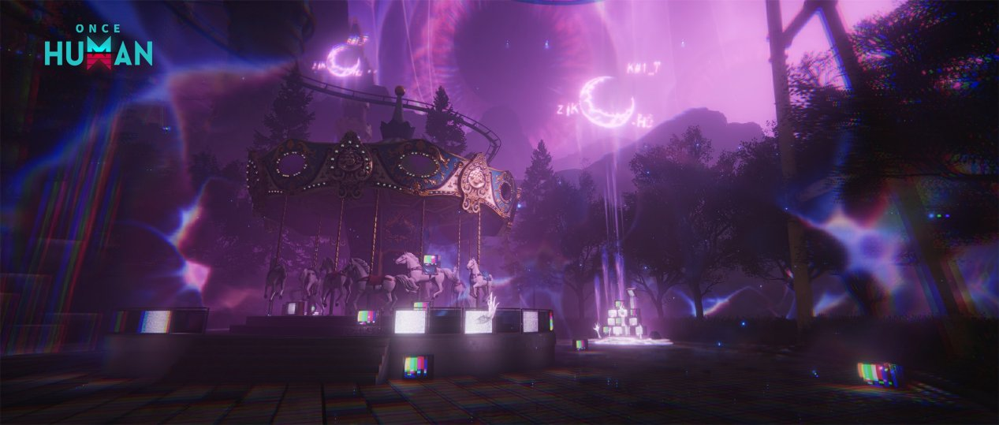

# 깊은 잠 <small>(무깊)</small>

!!! abstract "한눈에 보기"
    정식 명칭은 **깊게 잠든 자**입니다. [얕은 잠](shallow-sleep.md)에게 버프를 받고, [영면의 킨](kin.md)에게 버프를 줍니다.
    **무깊**(무한 깊잠)은 무얕과 같은 원리로 깊은 잠을 한자리에서 반복 파밍하는 방법입니다.

!!! warning "작성 기준"
    2025년 커뮤니티 글을 바탕으로 정리했습니다. 패치로 수치나 동작이 달라졌을 수 있습니다.

## 기본 정보

| 항목 | 내용 |
|------|------|
| 활성화 비용 | [자각의 모래](index.md#자각의-모래-얻는-법) 100개 |
| 대기 시간 | 없음 (바로 웨이브 시작) |
| 버프 | 주변 [얕은 잠](shallow-sleep.md)에게 받음 |
| 영역 상태이상 | 1개 ([벼락 · 폭탄 · 암흑](nightmare-laws.md)) |

<small>출처: [Once Human 공식 공지](https://www.oncehuman.game/kr/news/update/20250521/40776_1235674.html)</small>

## 준비물

- **지반, 원형 계단 재료**: 마지막 목표가 높은 곳에 있어서 올라갈 길을 직접 지어야 합니다. 꿈의 영역 안에서도 건축할 수 있습니다.

## 공략

### 0. (선택) 주변 얕은 잠 먼저 정리

깊은 잠에 버프를 주는 [얕은 잠](shallow-sleep.md)을 먼저 잡으면 그 버프가 사라집니다.

### 1. 일반 변이체 웨이브

활성화하면 4방향 게이트가 열리고 일반 변이체가 몰려옵니다. **결계 안에서 잡아야** 처치 게이지가 오릅니다.

### 2. 빨간 결계 엘리트

일정 수를 잡으면 빨간 결계를 두른 엘리트가 나옵니다. 이 엘리트를 잡으면 **덴드라이트**와 그 주변 발판이 생깁니다.

### 3. 덴드라이트 파괴

지반을 깔고 원형 계단을 지어 결계 안까지 올라간 뒤 덴드라이트를 부숩니다.

## 무깊 (무한 깊잠)

### 만드는 법

1. 킨(서번트)에 연결된 깊은 잠 중 **남길 자리 하나**를 정합니다.
2. 나머지 깊은 잠을 잡고 그 자리에 영지 코어를 박습니다.
3. 남긴 자리로 가서 다시 생기는지 확인합니다.
4. 엉뚱한 곳에 새로 생겼다면 그것도 잡고 영지를 박습니다. 원하는 자리에 다시 생길 때까지 반복합니다.

!!! tip "추천 장소"
    **잿더미 해변**의 킨에 연결된 깊은 잠 자리가 만들기 쉽다고 알려져 있습니다. 보통 워프석 근처처럼 모이기 편한 곳으로 정합니다.
    설산 지역은 경사가 심해서 저중력 시간에 작업하는 게 편합니다.

### 장점

- 박아 둔 영지를 빼지 않는 한 같은 자리에서 계속 돌 수 있습니다.
- 다른 플레이어가 없앨 수 없습니다.
- 같은 자리에서 무얕과 함께 돌릴 수 있습니다.

## 추천 총기

| 무기 | 종류 | 빌드 시트 |
|------|------|-----------|
| **G17 - 위험물 (폭글록)** | 권총 | [:material-google-spreadsheet: 빌드 보기](https://docs.google.com/spreadsheets/d/1UEGz2lsRZplKnUekpb7x1KbgcoPnfPaIQxWSmx4_WMc/edit?gid=1177753503#gid=1177753503){ target="_blank" } |
| **서리 스카 - 우주 방문객** | 소총 | [:material-google-spreadsheet: 빌드 보기](https://docs.google.com/spreadsheets/d/1UEGz2lsRZplKnUekpb7x1KbgcoPnfPaIQxWSmx4_WMc/edit?gid=1798601486#gid=1798601486){ target="_blank" } |
| **SN700 - 절향** <small>보조 무기: 탈출 불가</small> | 저격소총 <small>컴파운드 보우</small> | [:material-google-spreadsheet: 절향](https://docs.google.com/spreadsheets/d/1UEGz2lsRZplKnUekpb7x1KbgcoPnfPaIQxWSmx4_WMc/edit?gid=1104134783#gid=1104134783){ target="_blank" } [:material-google-spreadsheet: 탈출 불가](https://docs.google.com/spreadsheets/d/1UEGz2lsRZplKnUekpb7x1KbgcoPnfPaIQxWSmx4_WMc/edit?gid=1275908954#gid=1275908954){ target="_blank" } |
| **AK - 심연의 응시** | 소총 | [:material-google-spreadsheet: 빌드 보기](https://docs.google.com/spreadsheets/d/1UEGz2lsRZplKnUekpb7x1KbgcoPnfPaIQxWSmx4_WMc/edit?gid=234116370#gid=234116370){ target="_blank" } |
| **MK - 문어! 구이 링!** | 저격소총 | [:material-google-spreadsheet: 빌드 보기](https://docs.google.com/spreadsheets/d/1UEGz2lsRZplKnUekpb7x1KbgcoPnfPaIQxWSmx4_WMc/edit?gid=1183237888#gid=1183237888){ target="_blank" } |

<small>빌드 출처: [원스휴먼 총기 빌드 시트](https://docs.google.com/spreadsheets/d/1UEGz2lsRZplKnUekpb7x1KbgcoPnfPaIQxWSmx4_WMc/edit?gid=2128228509#gid=2128228509)</small>

## 출처

- [무한 깊잠 - 원스휴먼 마이너 갤러리](https://m.dcinside.com/board/oncehumankor/213969)
- [주관적인 무한한 꿈 공략 : 얕게 잠든 자, 깊게 잠든 자](https://gall.dcinside.com/mgallery/board/view/?id=oncehumankor&no=188474)
- [주관적인 무한한 꿈 공략 : 간략한 필드 구성](https://m.dcinside.com/board/oncehumankor/188032)
- [무한한 꿈 기본공략 - 원스휴먼 채널](https://arca.live/b/oncehuman/137776094)

---

[:octicons-arrow-left-24: 무한한 꿈으로 돌아가기](index.md)
