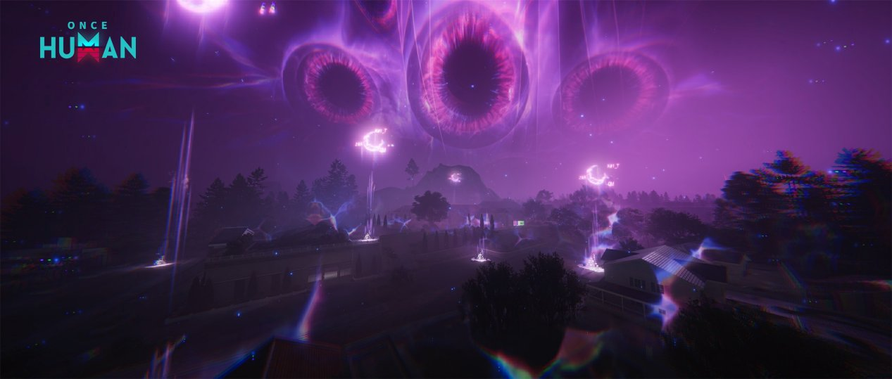

# 무한한 꿈 <small>(무꿈)</small>

!!! abstract "한눈에 보기"
    맵에 퍼진 **꿈의 영역**을 정화하는 시나리오입니다.
    악몽은 [얕은 잠](shallow-sleep.md) → [깊은 잠](deep-sleep.md) → [영면자 (킨)](kin.md) 순서로 버프를 주는 피라미드 구조이고, 마지막 주차에는 [실버게이트](silvergate.md)에서 다키니를 잡습니다.


<small>출처: [Once Human 공식 공지](https://www.oncehuman.game/kr/news/update/20250521/40776_1235674.html)</small>

!!! warning "작성 기준"
    직접 정리한 내용에 2025년 공식 공지와 커뮤니티 글을 더해 정리했습니다. 패치로 수치가 달라졌을 수 있습니다.

## 세부 공략

<div class="grid cards" markdown>

-   :material-weather-night:{ .lg .middle } **얕은 잠** <small>무얕</small>

    ---

    자각의 모래 50 · 무한 얕잠 파밍

    [:octicons-arrow-right-24: 바로가기](shallow-sleep.md)

-   :material-moon-waning-crescent:{ .lg .middle } **깊은 잠** <small>무깊</small>

    ---

    자각의 모래 100 · 무한 깊잠 파밍

    [:octicons-arrow-right-24: 바로가기](deep-sleep.md)

-   :material-coffin:{ .lg .middle } **영면자 (킨)** <small>무킨</small>

    ---

    자각의 모래 1000 · 시나리오 주요 목표

    [:octicons-arrow-right-24: 바로가기](kin.md)

-   :material-gate:{ .lg .middle } **실버게이트** <small>다키니 · 터치 오브 스카이</small>

    ---

    최종 콘텐츠 · 다키니런

    [:octicons-arrow-right-24: 바로가기](silvergate.md)

-   :material-weather-lightning:{ .lg .middle } **무꿈 영역 현상**

    ---

    벼락 · 폭탄 · 암흑 대처법

    [:octicons-arrow-right-24: 바로가기](nightmare-laws.md)

-   :material-table-star:{ .lg .middle } **클리어 보상 표**

    ---

    망각 · 만하임 · 무꿈 콘텐츠 보상 비교

    [:octicons-arrow-right-24: 바로가기](rewards.md)

</div>

## 주요 재화

| 재화 | 쓰는 곳 | 얻는 곳 |
|------|---------|---------|
| **자각의 모래** | [얕은 잠](shallow-sleep.md), [깊은 잠](deep-sleep.md), [영면자](kin.md) 활성화 | [아래 참고](#자각의-모래-얻는-법) |
| **현실 조각** | [회상 양 상점](sheep-shop.md) 구매, [영면자](kin.md) · [다키니](silvergate.md) 추가 보상 | [얕은 잠](shallow-sleep.md), [깊은 잠](deep-sleep.md) 처치 |

!!! tip "현실 조각은 미리 모아 두세요"
    영면자와 다키니 추가 보상에 현실 조각이 들어갑니다. [무얕](shallow-sleep.md#무얕-무한-얕잠)이 가장 보편적인 파밍 방법입니다.

각 콘텐츠의 클리어 보상은 [클리어 보상 표](rewards.md)에 정리했습니다.

### 자각의 모래 얻는 법

자각의 모래는 **꿈의 영역 안에서만** 모을 수 있습니다. 맵을 열면 곳곳에 보이는 악몽 지역으로 가면 됩니다.

| 방법 | 설명 |
|------|------|
| :material-clock-outline: **자각의 시계 채굴** (주력) | 곡괭이나 드릴로 캡니다. **시계가 길수록** 많이 줍니다. |
| :material-skull-outline: 꿈의 영역 적 처치 | 적을 잡으면 얻습니다. |
| :material-television-classic: 나이트메어 TV | 잡으면 나오는 상자에서 얻습니다. |
| :material-treasure-chest: 걸어다니는 상자 | 유실 장비, 결정, 에테르와 함께 나옵니다. |
| :material-pickaxe: 재료 채집 · 아이템 수집 | 영역 안에서 채집하면 얻습니다. |

<div class="oh-img-placeholder">이미지 준비 중 · images/endless-dream/awareness-clock.png (자각의 시계)</div>

[:material-pickaxe: 채광세팅 시트 열기](https://docs.google.com/spreadsheets/d/1UEGz2lsRZplKnUekpb7x1KbgcoPnfPaIQxWSmx4_WMc/edit?gid=1127561707#gid=1127561707){ .md-button .md-button--primary target="_blank" }

!!! tip "자각의 시계 팁"
    - 채굴 판정이 시계 **가운데**에 있습니다. 높은 시계는 ++b++ 키로 지반을 깔고 올라가서 캡니다. 바이크로 점프해서 올라가도 됩니다.
    - [악몽 법칙](nightmare-laws.md)의 **벼락이나 폭탄**이 시계를 맞히게 유도하면 시계가 부서집니다.
    - **물고기 통조림**을 먹고 캐면 더 많이 나옵니다.
    - 워프 타워 근처 시계는 세계를 바꿔 가며 캐면 효율이 좋습니다.

#### 주요 파밍 지역

| 지역 | 내용 |
|------|------|
| :material-snowflake: **설산** | 모래(자각의 시계)가 많다는 후기가 있습니다. 사람이 잘 안 다니는 곳에 시계가 많이 보인다고 합니다. 경사가 심하니 저중력 시간대를 노리세요. |
| :material-transit-connection-variant: **워프 타워 근처** | 이동이 빨라서 세계를 바꿔 가며 캐기 좋습니다. 단, 근처에 영지가 있으면 꿈의 영역이 생기지 않습니다. |

!!! note "좌표는 따로 없음"
    시계 위치가 정리된 좌표 자료는 찾지 못했습니다. 스폰 위치가 대략 2주마다 바뀐다는 후기도 있어서, 맵의 **악몽 지역**을 하나씩 돌며 시계를 찾는 방식이 기본입니다.

!!! danger "주의"
    - 꿈의 영역 안에 **15분** 넘게 있으면 부활 기회 없이 밖으로 쫓겨납니다.
    - 워프 타워 주변에 영지가 있으면 꿈의 영역이 생기지 않아서 모래를 캘 수 없습니다.
    - 모래 스폰 위치는 대략 2주마다 바뀐다는 후기가 있습니다.

## 피라미드 구조

```
          영면자 (킨)
         ↑ 버프 ↑
     깊은 잠    깊은 잠
     ↑ 버프 ↑   ↑ 버프 ↑
   얕은 잠 …   얕은 잠 …
```

- 맵에서 **영면자를 클릭**하면 그 영면자에게 버프를 주는 [깊은 잠](deep-sleep.md)이 표시됩니다.
- **[깊은 잠](deep-sleep.md)을 클릭**하면 그 깊은 잠에게 버프를 주는 [얕은 잠](shallow-sleep.md) 영역이 표시됩니다.
- 아래 단계를 잡으면 위 단계에 걸린 버프가 사라집니다. 그래서 [얕은 잠](shallow-sleep.md) → [깊은 잠](deep-sleep.md) 순서로 정리하고 영면자에 도전합니다.

<div class="oh-img-placeholder">이미지 준비 중 · images/endless-dream/pyramid-map.png (맵에서 영면자 클릭 화면)</div>

### 버프 종류

| 아이콘 | 버프 | 효과 |
|:------:|------|------|
| <span class="oh-icon-placeholder">?</span> | 가하는 피해 증가 | 스택당 +10% |
| <span class="oh-icon-placeholder">?</span> | 받는 피해 감소 | 스택당 -10% |
| <span class="oh-icon-placeholder">?</span> | 쉴드 버블 생성 | 버블을 맞히면 피해 무효 |

<!-- 아이콘 이미지 넣으면 <span class="oh-icon-placeholder">?</span> 를 { width="32" } 로 바꾸기 -->

### 무꿈 영역 상태이상

- 각 [깊은 잠](deep-sleep.md)은 **무꿈 영역 상태이상을 1개씩** 가집니다.
- 상태이상은 **벼락 · 폭탄 · 암흑** 3종류입니다. 공략은 [무꿈 영역 현상](nightmare-laws.md) 페이지에 정리했습니다.
- 영면자는 [깊은 잠](deep-sleep.md)을 **최소 1개** 가지므로, 상태이상도 최소 1개 가집니다. 깊은 잠을 여러 개 남겨 두면 영면자전에서 상태이상이 섞여서 나옵니다.

## 진행 방식

- 무꿈은 **총 5시즌**으로 진행되고, 주차마다 새로 열리는 영면자가 따로 있습니다.
- 그 주차에 열린 **영면자를 모두 처치**하면 다음 시나리오 진입 기간이 줄어듭니다.
- **마지막 주차**에는 맵 곳곳에 [실버게이트](silvergate.md)가 생깁니다. 들어가면 터치 오브 스카이(다키니)를 잡을 수 있습니다.

!!! info "꿈의 문 = 실버게이트"
    개별 영면자 **20마리 이상** 처치에 참여했다면, 영지에 설치한 **꿈의 문**이 실버게이트 역할을 합니다. 실버게이트를 찾아다닐 필요가 없습니다.
    20마리를 못 채웠다면 맵에 생긴 실버게이트를 직접 찾아가면 됩니다.

## 이렇게 돌면 됩니다

세계 채팅에서 열리는 판에 참여하거나 직접 열어서 아래 콘텐츠를 열심히 도는 것이 주 목표입니다.

| 목적 | 콘텐츠 |
|------|--------|
| :material-download: 현실 조각 **모으기** | [무얕](shallow-sleep.md#무얕-무한-얕잠), [무깊](deep-sleep.md#무깊-무한-깊잠) |
| :material-upload: 현실 조각 **쓰기** | [무킨](kin.md#무킨), [다키니](silvergate.md) |

## 추천 총기 빌드

[:material-google-spreadsheet: 추천 총기 빌드 시트 열기][sheet]{ .md-button .md-button--primary target="_blank" }
[:material-pistol: 총기별 추천 콘텐츠](../../builds/index.md){ .md-button }

<small>원본 시트: <https://docs.google.com/spreadsheets/d/1UEGz2lsRZplKnUekpb7x1KbgcoPnfPaIQxWSmx4_WMc/edit?gid=2128228509#gid=2128228509></small>

## 같이 보기

- [모듈 정리](../../module/index.md)

## 출처

- [<무한한 꿈> 얼리 액세스 공지 - Once Human 공식](https://www.oncehuman.game/kr/news/update/20250521/40776_1235674.html)
- [주관적인 무한한 꿈 공략 : 기타 팁, 육성 루트, 중요 자원](https://m.dcinside.com/board/oncehumankor/188556)
- [무한의 꿈 자각의 시계](https://m.dcinside.com/board/oncehumankor/174563)
- [다시 쓰는 무한한 꿈 기초 가이드(수정)](https://m.dcinside.com/board/oncehumankor/182205)
- [무꿈 자각의 모래 파밍방법은 없어?? - 원스휴먼 채널](https://arca.live/b/oncehuman/142962201)
- [무한한 꿈 대충 정리해옴](https://gall.dcinside.com/mgallery/board/view/?id=oncehumankor&no=173569)

[sheet]: https://docs.google.com/spreadsheets/d/1UEGz2lsRZplKnUekpb7x1KbgcoPnfPaIQxWSmx4_WMc/edit?gid=2128228509#gid=2128228509
