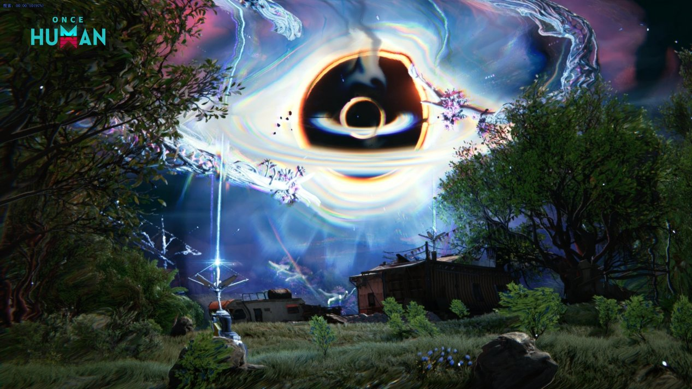

# 영면자 (킨) <small>(무킨)</small>

!!! abstract "한눈에 보기"
    정식 명칭은 **영면의 킨**입니다. 지도에 눈 모양으로 표시되는 무한한 꿈의 주요 목표이고, 잡은 킨의 수에 따라 시나리오 엔딩이 정해집니다.
    [얕은 잠](shallow-sleep.md) → [깊은 잠](deep-sleep.md) → 킨 순서로 버프가 쌓이는 **피라미드 구조**라서, 아래 단계부터 정리하는 게 핵심입니다.

!!! warning "작성 기준"
    2024~2025년 커뮤니티 글을 바탕으로 정리했습니다. 패치로 수치나 동작이 달라졌을 수 있습니다.

## 기본 정보

| 항목 | 내용 |
|------|------|
| 활성화 비용 | [자각의 모래](index.md#자각의-모래-얻는-법) 1000개 (첫 처치) |
| 잔영 활성화 비용 | 자각의 모래 2000개 (재도전) |
| 버프 | 주변 [깊은 잠](deep-sleep.md)의 [법칙](nightmare-laws.md) + [얕은 잠](shallow-sleep.md)의 버프를 모두 받음 |
| 처치 후 | 사라지지 않고 **킨의 잔영**으로 남음 |
| 보상 | 첫 처치 보상은 우편으로 지급. **현실 조각은 주지 않음** |
| 추가 보상 | 현실 조각을 써서 무기 · 마스크 모듈 상자 (키워드만) · [보상 표](rewards.md) |

!!! info "처음인지 재도전인지 구분하기"
    킨을 클릭했을 때 이름에 **잔영**이 붙어 있거나 아이콘이 다르면 이미 잡은 킨입니다.

<small>출처: [Once Human 공식 공지](https://www.oncehuman.game/kr/news/update/20250521/40776_1235674.html)</small>

## 준비

- **버프 걷어내기**: 지도에서 킨을 클릭해 어떤 깊은 잠이 버프를 주는지 확인하고, 필요 없는 버프를 주는 [깊은 잠](deep-sleep.md)을 먼저 잡습니다. 보통 **생명 공생**(피해 감소 버프)을 3 이하로 낮추고 도전합니다.
- **로드아웃**: 상위자 대상 피해 %, 엘리트 대상 피해 % 위주로 맞춥니다.
- **텐트**: 지형이 험하거나 좁은 곳의 킨은 근처에 텐트를 따로 설치해 둡니다.
- **현실 조각**: 보상을 받으려면 현실 조각이 필요하도록 바뀌었습니다. [무얕](shallow-sleep.md#무얕-무한-얕잠)으로 미리 모아 두세요.

## 공략

### 현실 앵커 관리

현실 앵커는 쿨타임이 **30분**입니다. 체력이 많거나 위치를 강제로 옮기는 패턴이 있는 킨은 오래 걸리니, 쿨타임을 확인하는 습관을 들입니다.

!!! danger "상실 값 주의"
    킨을 잡아도 꿈의 영역은 사라지지 않습니다. 보상을 줍기 전에 상실 값이 다 차서 지옥으로 떨어지면 보상을 못 받을 수 있습니다.

### 회피

유연하게 피할 수 있는 수단은 사실상 **거친 물결**뿐이라는 의견이 많습니다.

### 킨별 주요 패턴

| 킨 | 패턴 | 대응 |
|----|------|------|
| 라베노스 헌터 | 12시 방향 미사일 발사 → 빨간 마크 → 착탄 | 마크를 보고 피함. 악몽 법칙이 번개·폭발이면 그 투사체도 함께 피함 |
| (블랙홀 패턴 킨) | 블랙홀 생성 후 벽 생성 | 블랙홀이 보이자마자 거친 물결로 빠져나옴 |
| 세이렌 | 머리 위 번개 | 꿈의 영역 안에 **피뢰침**을 지어 대응 |

## 무킨

(작성 필요: 무킨 방식은 커뮤니티 글에서 확인하지 못했습니다. 내용을 알려주시면 채워 넣겠습니다.)

## 출처

- [주관적인 무한한 꿈 공략 : 킨(상위자) 공략 준비](https://m.dcinside.com/board/oncehumankor/188502)
- [주관적인 무한한 꿈 공략 : 킨 패턴](https://gall.dcinside.com/mgallery/board/view/?id=oncehumankor&no=188542)
- [다시 쓰는 무한한 꿈 기초 가이드(수정)](https://m.dcinside.com/board/oncehumankor/182205)
- [무한의 꿈 기초가이드](https://gall.dcinside.com/mgallery/board/view/?id=oncehumankor&no=175392)
- [무한 얕잠 공략](https://gall.dcinside.com/mgallery/board/view/?id=oncehumankor&no=195364)

---

[:octicons-arrow-left-24: 무한한 꿈으로 돌아가기](index.md)
