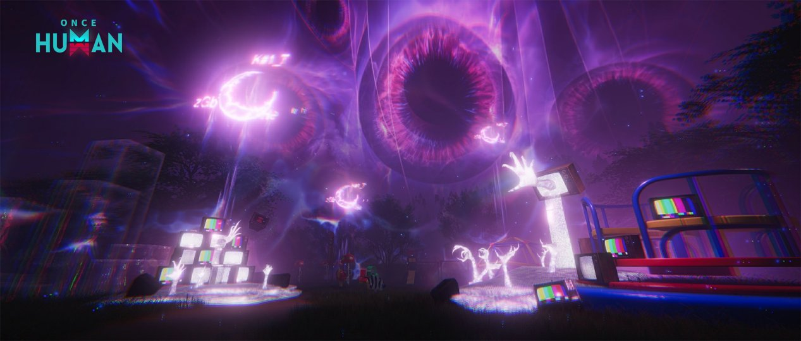

# 얕은 잠 <small>(무얕)</small>

!!! abstract "한눈에 보기"
    정식 명칭은 **얕게 잠든 자**입니다. 무한한 꿈의 악몽 중 가장 낮은 단계이고, 주변의 [깊은 잠](deep-sleep.md)에 버프를 줍니다.
    **무얕**(무한 얕잠)은 같은 자리에서 얕은 잠을 계속 다시 생기게 해서 반복 파밍하는 방법입니다.

!!! warning "작성 기준"
    2025~2026년 커뮤니티 글을 바탕으로 정리했습니다. 패치로 수치나 동작이 달라졌을 수 있습니다.

## 기본 정보

| 항목 | 내용 |
|------|------|
| 활성화 비용 | [자각의 모래](index.md#자각의-모래-얻는-법) 50개 |
| 대기 시간 | 활성화 후 약 1분 30초 |
| 처치 제한 시간 | 약 3분 30초 |
| 지도 표시 | 없음 |

## 찾는 법

얕은 잠은 지도에 표시되지 않습니다. 악몽 필드에 쌓인 **TV 탑의 화면 색**으로 구분합니다.

- :material-circle:{ style="color:#ff8fc8" } 분홍색: 얕은 잠
- :material-circle:{ style="color:#b18cff" } 보라색: 깊은 잠
- :material-circle:{ style="color:#ffcc4d" } 금색: 영면의 킨

<small>출처: [Once Human 공식 공지](https://www.oncehuman.game/kr/news/update/20250521/40776_1235674.html)</small>

## 공략

### 1. 드림가이(소형 TV) 먼저 처리

활성화하면 4방향에 게이트가 열리고 주변에 **소형 TV 몬스터(드림가이) 4마리**가 나옵니다. 이 몬스터가 얕은 잠의 체력을 회복시키므로 **가장 먼저 잡아야 합니다.**

!!! tip "팁"
    드림가이 처리에는 감염물 **서리**가 많이 추천됩니다. 포탈마다 서리를 하나씩 붙여 두면 계속 묶어 둘 수 있다는 후기가 있습니다.

### 2. 본체 처치

드림가이를 정리한 뒤 제한 시간 안에 본체를 잡습니다.

## 무얕 (무한 얕잠)

### 원리

- 깊은 잠 주변에는 얕은 잠이 **최소 개수만큼 유지**되도록 되어 있습니다.
- 최소 개수에서 1개를 잡아도 새로 생기지 않습니다. **2개째를 잡는 순간** 다시 생깁니다.
- 얕은 잠이 생길 수 있는 자리에 **영지 코어**를 박으면 그 자리에는 아예 생기지 않습니다.

### 만드는 법

1. 깊은 잠을 클릭해서 연결된 얕은 잠 4곳을 찾습니다.
2. 남길 자리(공생 마크가 없는 쪽)를 일렬로 정하고, 나머지 스폰 자리에는 전부 영지 코어를 박습니다.
3. 남은 자리에서만 얕은 잠이 반복해서 생깁니다.

### 도는 순서

자리를 1~4번으로 놓고 **2 → 1 → 3 → 4** 또는 **3 → 4 → 2 → 1** 순서로 잡습니다.
바깥쪽(1·4번)을 잡는 동안 안쪽(2·3번)을 얼마나 빨리 열어 두느냐가 핵심입니다.

### 주의사항

!!! danger "깊은 잠을 잡지 마세요"
    깊은 잠을 잡으면 최소 개수 조건이 초기화되고 스폰 위치도 무작위로 바뀝니다. 무얕 자리를 유지하려면 연결된 깊은 잠은 건드리지 않습니다.

- 물 위에 생긴 얕은 잠과 엘리트는 공격할 수 없습니다.
- 깊은 잠 영역의 변이체를 끌고 오면 어그로가 풀리지 않고 계속 따라옵니다.
- 무얕은 **현실 조각**을 모으기 좋은 방법이라, 킨과 실버게이트 보상을 받기 전에 미리 돌아두라는 조언이 많습니다.

## 추천 총기

| 무기 | 종류 | 빌드 시트 |
|------|------|-----------|
| **SN700 - 절향** | 저격소총 | [:material-google-spreadsheet: 빌드 보기](https://docs.google.com/spreadsheets/d/1UEGz2lsRZplKnUekpb7x1KbgcoPnfPaIQxWSmx4_WMc/edit?gid=1104134783#gid=1104134783){ target="_blank" } |

<small>빌드 출처: [원스휴먼 총기 빌드 시트](https://docs.google.com/spreadsheets/d/1UEGz2lsRZplKnUekpb7x1KbgcoPnfPaIQxWSmx4_WMc/edit?gid=2128228509#gid=2128228509)</small>

## 출처

- [무한 얕잠 공략 - 원스휴먼 마이너 갤러리](https://gall.dcinside.com/mgallery/board/view/?id=oncehumankor&no=195364)
- [주관적인 무한한 꿈 공략 : 얕게 잠든 자, 깊게 잠든 자](https://gall.dcinside.com/mgallery/board/view/?id=oncehumankor&no=188474)
- [깨달았다. 무얕 만드는법](https://gall.dcinside.com/mgallery/board/view/?id=oncehumankor&no=273621)
- [무얕 원리좀 설명해줘](https://gall.dcinside.com/mgallery/board/view/?id=oncehumankor&no=273492)
- [무한한꿈 얕은잠을자는자 공략](https://m.dcinside.com/board/oncehumankor/174809)

---

[:octicons-arrow-left-24: 무한한 꿈으로 돌아가기](index.md)
